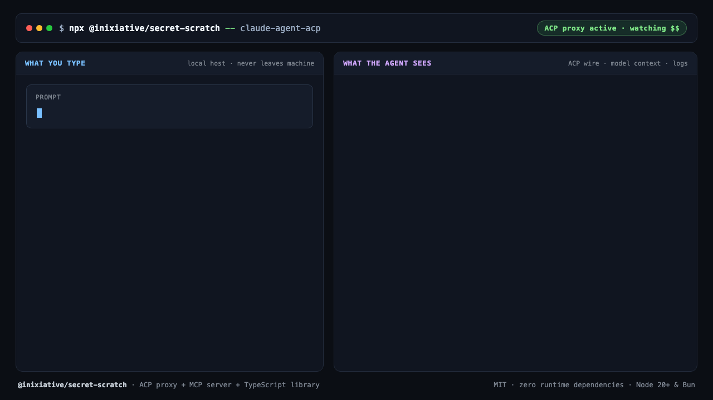

# secret-scratch

Pass secrets to coding agents as `$$value` without the LLM, transcript, or logs ever seeing them.



```text
You type:       Put $$sk_live_9876543210 into .env.local as STRIPE_KEY, then push it to GitHub Actions.
Agent sees:     Put †m1.1 into .env.local as STRIPE_KEY, then push it to GitHub Actions.
Agent calls:    secret_scratch(action: "env", ref: "†m1.1", path: ".env.local", key: "STRIPE_KEY")
                secret_pipe(envFile: ".env.local", key: "STRIPE_KEY", command: "gh secret set STRIPE_KEY")
Agent gets:     { ok: true, exitCode: 0 }
Agent tries:    cat .env.local  ->  BLOCKED (.env.local is held by secret-scratch)
```

Zero runtime dependencies. Works with Node.js 20+ and Bun 1.4+. Ships three ways to integrate:

1. **Drop-in Agent Client Protocol (ACP) middleware proxy** (`secret-scratch -- <acp-agent-command>`) wrapping Claude ACP, Codex ACP, Gemini CLI ACP, or any ACP agent inside hosts such as Zed and JetBrains.
2. **Stdio MCP server** (`secret-scratch mcp`) exposing `secret_scratch` and `secret_pipe`.
3. **TypeScript library** (`@inixiative/secret-scratch`) for custom harnesses and agent runtimes.

## Why

Pasting an API key or private key into a coding agent chat sends the secret to the model provider, writes it into session transcripts, and leaves it in tool logs and crash dumps.

`secret-scratch` intercepts secrets before they reach the model:

1. **Lift before inference.** Any word prefixed with `$$` (plus common shaped tokens such as `sk-...`, `ghp_...`, `AKIA...`, `AIza...`, and PEM private keys if you forget the prefix) is moved into a `0600` per-thread scratch pad file in `~/.secret-scratch/` (`0700`) and replaced with an opaque reference like `†m1.1`.
2. **Use by reference.** The agent receives two MCP tools: `secret_scratch` (`list`, `env`, `write`, `consume`) and `secret_pipe` (pipes a secret to a shell command's `stdin`, discards `stdout` and `stderr`, returns only `exitCode`).
3. **Block access to held files.** Every file written by `secret_scratch` is recorded in `held-files.json`. ACP permission requests, filesystem calls, and terminal calls targeting a held file, a `.private` path, or the scratch pad directory are denied at the proxy boundary.
4. **Scrub outgoing updates.** Held values (6+ characters) are scrubbed from outgoing `session/update` frames back into their `†` reference as defense in depth.

## Quick start (ACP proxy)

Wrap any ACP agent command with `npx @inixiative/secret-scratch --`:

```bash
npx -y @inixiative/secret-scratch -- <your-acp-agent-command> [args...]
```

Or install globally:

```bash
npm install -g @inixiative/secret-scratch
secret-scratch -- <your-acp-agent-command> [args...]
```

### Example: Zed (`settings.json`)

```json
{
  "agent_servers": {
    "Claude Code (secret-scratch)": {
      "command": "npx",
      "args": ["-y", "@inixiative/secret-scratch", "--", "claude-agent-acp"]
    },
    "Codex (secret-scratch)": {
      "command": "npx",
      "args": ["-y", "@inixiative/secret-scratch", "--", "codex-acp"]
    },
    "Gemini CLI (secret-scratch)": {
      "command": "npx",
      "args": ["-y", "@inixiative/secret-scratch", "--", "gemini", "--experimental-acp"]
    }
  }
}
```

When a session starts, the proxy:

- Injects the `secret-scratch` stdio MCP server into `session/new`, `session/load`, `session/resume`, and `session/fork` (preserving all other MCP servers).
- Lifts `$$value` markers and recognised secret shapes on `session/prompt` before forwarding to the agent, attaching usage guidance on the first turn that carries a secret.
- Rejects `session/request_permission`, `fs/read_text_file`, `fs/write_text_file`, and `terminal/create` calls targeting held files, `.private` paths, or `~/.secret-scratch`.
- Scrubs held values out of `session/update` notifications.

### CLI flags

```text
secret-scratch [options] -- <acp-agent-command> [args...]
secret-scratch mcp --dir <path> --thread <id> [--cwd <path>]
secret-scratch list [--dir <path>] [--thread <id>]
secret-scratch clear <thread> [--dir <path>]

Options:
  --dir <path>          Scratch pad directory (default: ~/.secret-scratch)
  --private <glob>      Extra private path glob to block (repeatable)
  --no-lift-shaped      Only lift explicit $$value markers
  --no-scrub            Disable scrubbing held values from session/update
```

## Library usage

```ts
import {
  SecretScratchPad,
  SHAPED_SECRET_PATTERNS,
  privatePathGate,
  scratchTarget,
} from '@inixiative/secret-scratch';

const pad = new SecretScratchPad('~/.secret-scratch');

// 1. Lift before sending to the LLM
const { text, refs } = pad.lift(
  'Set STRIPE_KEY to $$sk_live_example1234567890 in .env.local',
  { thread: 'thread_1', message: 'm1' },
  { patterns: SHAPED_SECRET_PATTERNS },
);
// text === 'Set STRIPE_KEY to †m1.1 in .env.local'

// 2. Write safely inside cwd (rejects .., symlink escapes, .git, .claude, .ssh)
const target = scratchTarget(process.cwd(), '.env.local');
pad.env({ ref: refs[0]! }, 'thread_1', target, 'STRIPE_KEY', { consume: true });

// 3. Pipe straight to a CLI without returning stdout/stderr
const { exitCode } = await pad.pipe(
  { envFile: target, key: 'STRIPE_KEY' },
  'thread_1',
  'gh secret set STRIPE_KEY',
);

// 4. Gate agent file/shell tools
const gate = privatePathGate({
  scratchDir: pad.dir,
  heldFiles: pad.heldFiles(),
});
gate({ toolName: 'Bash', toolInput: { command: 'cat .env.local' } });
// { behavior: 'deny', message: '.env.local is private: ...' }
```

See [docs/VERBS.md](docs/VERBS.md) for the complete public API table.

## Security model and boundaries

- **Prevents accidental exposure to the LLM, agent transcripts, and tool output.** Secrets lifted at the prompt boundary never enter model context, prompt caches, or downstream agent session transcripts. `secret_pipe` discards `stdout` and `stderr` and kills the whole process group on timeout.
- **On-disk storage is `0600` plaintext in a `0700` directory.** Scratch pads live at `~/.secret-scratch/<thread>.pad` until consumed or cleared (`secret-scratch clear <thread>`). They protect against LLM and transcript leakage, not against another process running as your OS user.
- **Shell gating and `secret_pipe` defend against accidental leaks, not a hostile sandbox.** If a downstream agent runs shell commands directly inside its own process without asking the ACP host via `session/request_permission` or `terminal/create`, the ACP proxy cannot intercept those local subprocess calls. Likewise, an adversarial model that can pass arbitrary shell commands to `secret_pipe` could write stdin to an untracked file or encode bytes in the exit code. For enforcement against an untrusted model, pair `secret-scratch` with an OS sandbox or a harness that routes all tool calls through `privatePathGate` and restricts allowed pipe commands.
- **Single-word marker.** `$$value` lifts up to the next whitespace. Multi-line secrets (such as PEM private keys) are lifted by shape automatically; arbitrary multi-line secrets should be passed by file or env key rather than `$$`.

## Origin

Extracted from [Foundry](https://inixiative.com/foundry/), a source-available (BSL 1.1) local agent harness built by [inixiative](https://inixiative.com).

## License

MIT
